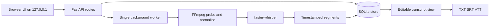

# Architecture — transcript-app

## Flow

## Modules

| Path | Responsibility |
| --- | --- |
| `app/__main__.py` | Launches uvicorn bound to `127.0.0.1`. |
| `app/main.py` | Builds the FastAPI app, mounts routes/static, starts and stops the worker. |
| `app/core/paths.py` | Resolves the per-user data, models, and log directories. |
| `app/core/config.py` | Env-backed defaults plus user settings persisted in SQLite. |
| `app/core/hardware.py` | Detects CUDA, VRAM, and RAM; recommends device + compute type. |
| `app/db/store.py` | SQLite schema, connection handling, and every query in the app. |
| `app/services/media.py` | FFmpeg/ffprobe discovery, validation, normalisation to 16 kHz mono WAV. |
| `app/services/transcriber.py` | Model cache and the Whisper call, including Taglish decoding options. |
| `app/services/worker.py` | Persistent single-job queue, progress, cancellation, cleanup. |
| `app/services/exporters.py` | TXT/SRT/VTT serialisation and timecode formatting. |
| `app/routes/pages.py` | HTML pages (library, transcript editor, settings). |
| `app/routes/api.py` | JSON API, media streaming with Range support, exports. |
| `app/web/` | Jinja templates and vanilla CSS/JS. No frontend build step. |

## Invariants

1. **One transcription at a time.** A single worker thread guards VRAM and RAM. Do not parallelise
   without revisiting the 4 GB VRAM budget.
2. **The database is the only source of truth for state.** A crash mid-job leaves a row in
   `running`; startup marks such rows `interrupted` so they can be retried.
3. **Media is referenced, never copied.** Only `source_path` is stored. If the file moves, the
   transcript survives but playback and retry fail with a clear error.
4. **Temporary audio is always deleted**, including on failure and cancellation.
5. **Edits never overwrite the model output.** `segments.text` holds the current text and
   `segments.original_text` holds what the model produced, so edits can be reverted.

## Job lifecycle

`queued` → `running` → (`completed` | `failed` | `canceled` | `interrupted`)

Progress is derived from the end timestamp of the most recent segment divided by the media duration,
so it advances smoothly for long files. The worker checks a cancel flag between segments.
